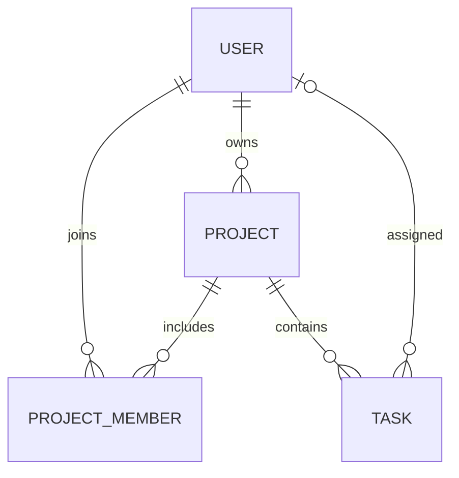
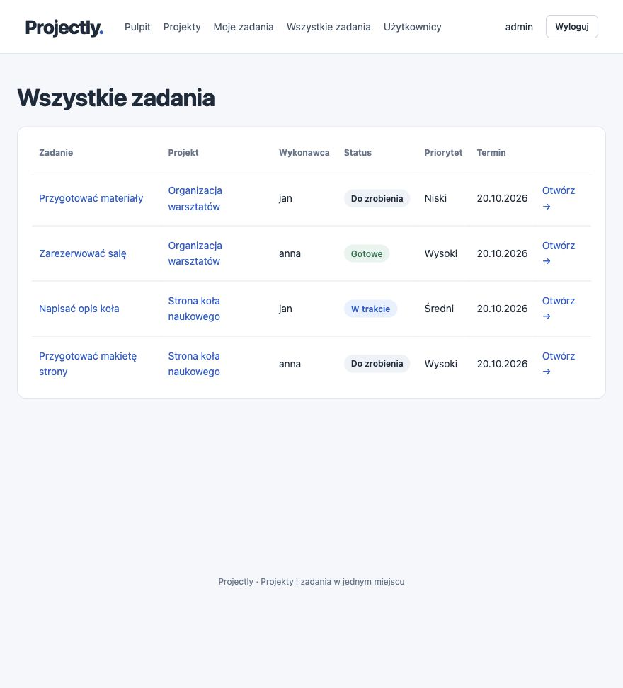

# Projectly

Projectly is a web application for managing projects, team members, and tasks.
Administrators manage accounts and organize work, while users browse available
projects and update the status of their tasks.
The application uses an MVC architecture and Thymeleaf views.

## Technologies and requirements

- JDK 21 (set `JAVA_HOME` to your JDK 21 installation).
- Spring Boot 3.5.16, Spring MVC, Spring Security.
- Hibernate / Spring Data JPA, Jakarta Validation, Thymeleaf.
- PostgreSQL 17 running through Docker Compose; H2 for integration tests.
- Docker Desktop with Docker Compose to run the database.
- Maven 3.9.11 downloaded by the included Maven Wrapper; no Maven installation is required.
- Internet access during the first build.

## Running the project with PostgreSQL in Docker

Docker runs the database, while the Spring Boot application runs locally in IntelliJ
or through Maven. The `compose.yaml` file uses the official `postgres:17-alpine` image,
a persistent data volume, and a database health check.

### 1. Prepare the project

Open the project in IntelliJ IDEA, select JDK 21, and reload Maven.
Run commands from the project root, alongside `pom.xml` and `compose.yaml`.

### 2. Prepare the configuration

If you do not have an `.env` file, copy `.env.example`:

```sh
cp .env.example .env
```

In Windows PowerShell, use `Copy-Item .env.example .env`.
Do not overwrite an existing `.env` file. Set your own passwords:

```properties
DB_NAME=projectly
DB_USERNAME=projectly
DB_PASSWORD=YourDatabasePassword123!
DB_HOST=localhost
DB_PORT=5432
SEED_ENABLED=true
SEED_PASSWORD=YourInitialPassword123!
SEED_RESET_USER=
```

The passwords above are examples. `DB_PASSWORD` is used to connect to PostgreSQL,
while `SEED_PASSWORD` is used when application accounts are first created.
The initial password must contain at least 6 characters and no more than 72 UTF-8 bytes.

### 3. Start the database

Start Docker Desktop, then run:

```sh
docker compose up -d --wait
docker compose ps
```

The PostgreSQL container should have a `healthy` status. Docker creates the
`projectly` database and the user specified in `.env`.

### 4. Start the application

```sh
./mvnw spring-boot:run
```

In Windows PowerShell, use `.\mvnw.cmd spring-boot:run`.
Alternatively, run the `org.example.ProjectlyApplication` class in IntelliJ.
Select JDK 21, set the working directory to the Projectly folder, and leave
`Active profiles` empty.

### 5. Log in as an administrator

Open [http://localhost:8080](http://localhost:8080).
Log in with the username `admin` and the account's current password.

When an empty database is first started with `SEED_ENABLED=true`, the initializer
creates an administrator account with the password specified by `SEED_PASSWORD`.
If the database already contains data, changing this value does not change existing
passwords. Use the password set when the account was created or last reset.
If you do not know it, follow the reset procedure below.

Passwords are stored as BCrypt hashes. After the initial data has been created,
you can set `SEED_ENABLED=false`.

### 6. Create a user account

1. As an administrator, open `Użytkownicy → Nowy użytkownik` (Users → New user).
2. Enter a unique username and email address, first name, last name, and password.
3. Select the `USER` role and check `Konto aktywne` (Account active).
4. Save the account.
5. Log out or open the application in a private browser window.
6. Log in with the username and password entered in the account creation form.

The account is available immediately, without restarting the application.
`SEED_PASSWORD` does not affect its password. The administrator can then add the
user to a project and assign tasks to them.

### Reset an existing account's password

Resetting a password does not require deleting the database or its volume.
Stop the application and set the following values in your local `.env` file:

```properties
SEED_ENABLED=true
SEED_PASSWORD=YourNewPassword123!
SEED_RESET_USER=admin
```

Restart the application. `DataInitializer` changes only the specified user's
password, storing a BCrypt hash. It does not change their role, active status,
projects, or tasks. Other accounts keep their passwords. You can specify another
username instead of `admin`. A nonexistent username or an invalid password causes
startup to fail with an error.

After a successful reset, remove `SEED_RESET_USER` from `.env` or leave its value
empty: `SEED_RESET_USER=`. Otherwise, the reset will run again on the next startup.
Without this option, the initializer continues to create data only in an empty database.

PostgreSQL is the default configuration. Compose and Spring Boot read the same
local `.env` file, which is ignored by Git. Use the simple `NAME=value` format
without quotes, spaces, `$`, `#`, or backslashes in passwords to keep it compatible
with both readers. Generated passwords use hexadecimal characters.
You can also set environment variables instead of using the file; they take precedence.

Connection settings for IntelliJ or a database tool:

| Parameter | Default value |
|---|---|
| Host | localhost |
| Port | 5432 |
| Database | projectly |
| User | projectly |
| Password | `DB_PASSWORD` value from `.env` |
| JDBC URL | jdbc:postgresql://localhost:5432/projectly |

If port 5432 is already in use, change `DB_PORT` in `.env`. The application and
Compose will use the new port. You can override the full connection URL with the
application's `DB_URL` variable. The database is exposed only on `127.0.0.1`.

In IntelliJ, select JDK 21 and set the working directory to the Projectly root.
Hibernate creates and updates the schema through `ddl-auto=update`.

Useful commands:

```sh
docker compose ps
docker compose logs postgres
docker compose exec postgres psql -U projectly -d projectly
docker compose stop
docker compose start --wait
```

Data remains in the `projectly_postgres_data` volume after the container is stopped
or recreated. Changing passwords in `.env` does not change the password in an
existing database; that requires a separate change in PostgreSQL. Do not delete
the volume if you want to keep your data.

Image documentation: [Docker Official Image PostgreSQL](https://hub.docker.com/_/postgres).
Configuration file loading:
[Spring Boot external configuration](https://docs.spring.io/spring-boot/3.5/reference/features/external-config.html).

## Building and testing

```sh
./mvnw clean verify
```

You can also run the built JAR from the project root after starting the database:

```sh
java -jar target/projectly-1.0.0.jar
```

The current JAR is generated in `target/`.

Integration tests use separate H2 databases, real JPA repositories, and MockMvc.
They cover users, projects, memberships, tasks, permissions, login, CSRF,
validation, and rendering all views with Open Session in View disabled.
They do not require a running PostgreSQL database.

The four unit tests in `BusinessRulesUnitTest` use plain service objects with
Mockito dependencies, without a Spring context, database, or Docker.
They check an already taken username, duplicate membership, assigning a task to
someone outside the project, and refusing a status change on another user's task.
They also verify that invalid data is not saved and the original status is preserved.
You can run just these tests:

```sh
./mvnw -Dtest=BusinessRulesUnitTest test
```

## Features

ADMIN:

- Dashboard with global statistics.
- Create and edit users, and delete or deactivate accounts.
- Create, edit, and delete projects; select an owner.
- Add and remove project members.
- Create, assign, edit, and delete tasks.
- TODO / IN_PROGRESS / DONE statuses, LOW / MEDIUM / HIGH priorities, and a due date.

USER:

- Dashboard with statistics for their own tasks and available projects.
- Access to projects they own or belong to.
- View their own tasks and filter them by status.
- View details and change the status of their own tasks only.

The scope does not include teams, diagrams, notes, reports, time tracking,
tickets, subtasks, comments, files, notifications, or a separate REST frontend.

## Structure

```text
src/main/java/org/example/
├── ProjectlyApplication.java
├── config/        SecurityConfig, DataInitializer
├── model/
│   ├── entity/    User, Project, ProjectMember, Task
│   ├── enums/     Role, TaskStatus, Priority
│   └── dto/       UserForm, ProjectForm, TaskForm
├── repository/    four JpaRepository interfaces
├── service/       UserService, ProjectService, TaskService, AccessService
├── controller/    login, dashboard, projects, tasks, users
└── exception/     exceptions and 400/403/404/409 handling
src/main/resources/
├── templates/     fragments, login, dashboard, projects, tasks, users, error
├── static/css/    responsive CSS without external dependencies
└── application.yml
src/test/          service and MVC flow tests
```

Requests flow through Controller → Service → Repository → Database.
Controllers handle forms and redirects; services contain transactions and business
rules. Forms do not bind entities directly or expose fields such as a task's
project ID or a password hash.

## Data model and rules



- `User`: unique username and email, first name, last name, BCrypt hash, role, and active status.
- `Project`: name, description, automatic creation date, and a required owner.
- `ProjectMember`: a separate join entity with a unique project/user pair
  and an automatic join date. No direct `@ManyToMany` relationship.
- `Task`: title, description, status, priority, optional due date, automatic creation
  date, required project, and optional assignee.

Relationships to individual entities use `LAZY` fetching; repositories fetch the
required data through `EntityGraph`. Collections of project child entities use only
`CascadeType.REMOVE` and `orphanRemoval`. No relationship cascades user deletion.
Inverse collections in `User` are intentionally omitted: the same relationships
are represented by foreign keys and repository queries. Entities do not have
equals/hashCode/toString methods that include relationships.

Additional rules:

- Owners can access their projects without an additional membership.
- Assignees must be active members or owners of the project.
- Removing a member unassigns their tasks; an administrator can reassign them.
- Changing the owner keeps the previous owner as a member, preserving existing
  assignments, and removes any additional membership of the new owner.
- Deleting a project removes its tasks and memberships while keeping users.
- Deleting a user with existing relationships deactivates the account; otherwise, it deletes the record.
- The last active administrator is protected against deactivation and role changes.
- Regular user edits preserve the existing password.
- Usernames and email addresses are normalized to lowercase.
- USER sees only their own tasks on a project page. ADMIN sees all tasks.
- Resource access rules are checked in services, including for manually crafted
  requests. Account active status is checked on subsequent operations.
- The role shown in navigation is read from the database; after a role change,
  the user must log in again to refresh the permissions stored in the Spring Security session.
- Session-based login, POST logout, and CSRF protection remain enabled.

## Demo walkthrough

1. Start PostgreSQL through Docker Compose, then start the application and log in as `admin`.
2. Create a user, project, and membership; add a task with an assignee.
3. Demonstrate empty-title validation and rejection of a duplicate membership.
4. Log in as the assignee and change the task status.
5. Demonstrate filtering in “Moje zadania” (My tasks) and restricted access to administration.
6. Log in as an administrator again, remove the member, and show the unassigned task.

## Preview



The project validation report is available in [docs/VALIDATION.md](docs/VALIDATION.md).
