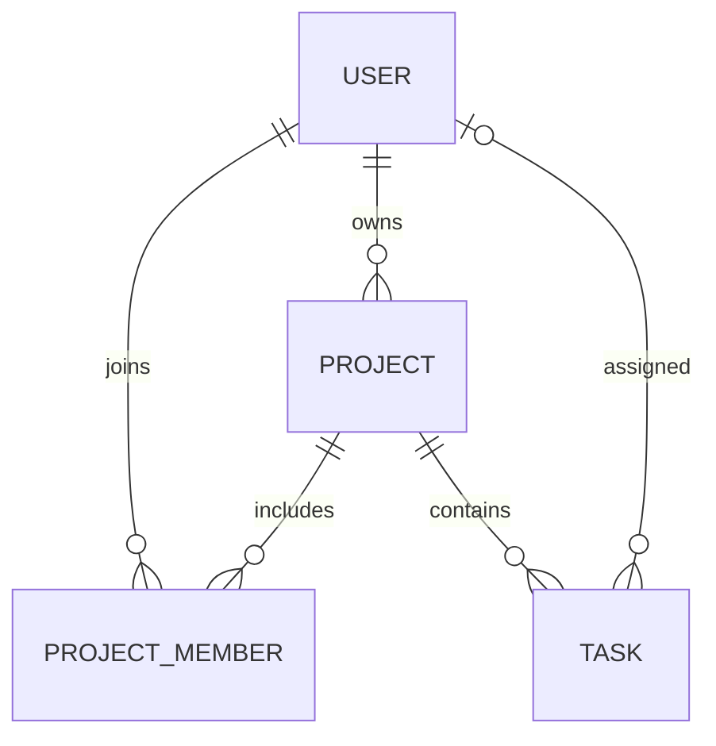

# Projectly

Projectly to aplikacja webowa do zarządzania projektami, członkami zespołów
i zadaniami. Administrator zarządza kontami i organizacją pracy, a użytkownicy
przeglądają dostępne projekty oraz aktualizują status swoich zadań.
Aplikacja wykorzystuje architekturę MVC i widoki Thymeleaf.

## Technologie i wymagania

- JDK 21 (ustaw `JAVA_HOME` na instalację JDK 21).
- Spring Boot 3.5.16, Spring MVC, Spring Security.
- Hibernate / Spring Data JPA, Jakarta Validation, Thymeleaf.
- PostgreSQL 17 uruchamiany przez Docker Compose; H2 do testów integracyjnych.
- Docker Desktop z Docker Compose do uruchomienia bazy.
- Maven 3.9.11 pobierany przez dołączony Maven Wrapper; nie trzeba instalować Maven.
- Dostęp do internetu podczas pierwszego budowania.

## Uruchomienie projektu z PostgreSQL w Dockerze

Docker uruchamia bazę danych, a aplikacja Spring Boot działa lokalnie w IntelliJ
lub przez Maven. Plik `compose.yaml` zawiera oficjalny obraz `postgres:17-alpine`,
trwały wolumen danych i kontrolę gotowości bazy.

### 1. Przygotuj projekt

Otwórz projekt w IntelliJ IDEA, ustaw JDK 21 i przeładuj Maven.
Polecenia wykonuj w głównym katalogu projektu, obok `pom.xml` i `compose.yaml`.

### 2. Przygotuj konfigurację

Jeśli nie masz pliku `.env`, skopiuj `.env.example`:

```sh
cp .env.example .env
```

W Windows PowerShell użyj `Copy-Item .env.example .env`.
Istniejącego pliku `.env` nie nadpisuj. Ustaw własne hasła:

```properties
DB_NAME=projectly
DB_USERNAME=projectly
DB_PASSWORD=TwojeHasloBazy123!
DB_HOST=localhost
DB_PORT=5432
SEED_ENABLED=true
SEED_PASSWORD=TwojeHasloPoczatkowe123!
SEED_RESET_USER=
```

Powyższe hasła są przykładami. `DB_PASSWORD` służy do połączenia z PostgreSQL,
a `SEED_PASSWORD` do pierwszego utworzenia kont w aplikacji. Hasło początkowe
musi mieć minimum 6 znaków i maksymalnie 72 bajty UTF-8.

### 3. Uruchom bazę

Uruchom Docker Desktop, a następnie:

```sh
docker compose up -d --wait
docker compose ps
```

Kontener PostgreSQL powinien mieć stan `healthy`. Docker przygotuje bazę
`projectly` oraz użytkownika wskazanego w `.env`.

### 4. Uruchom aplikację

```sh
./mvnw spring-boot:run
```

W Windows PowerShell użyj `.\mvnw.cmd spring-boot:run`.
W IntelliJ możesz zamiast tego uruchomić klasę `org.example.ProjectlyApplication`.
Ustaw JDK 21, katalog roboczy na folder Projectly i pozostaw pole
`Active profiles` puste.

### 5. Zaloguj się

Otwórz [http://localhost:8080](http://localhost:8080).
Przy pierwszym uruchomieniu pustej bazy i `SEED_ENABLED=true` aplikacja utworzy:

| Login | Hasło początkowe | Rola |
|---|---|---|
| admin | wartość `SEED_PASSWORD` z `.env` | ADMIN |
| anna | wartość `SEED_PASSWORD` z `.env` | USER |
| jan | wartość `SEED_PASSWORD` z `.env` | USER |

Utworzone zostaną również dwa przykładowe projekty, członkostwa i cztery zadania.
Hasła zapisują się jako hashe BCrypt. Inicjalizator tworzy te dane tylko wtedy,
gdy wszystkie cztery tabele są puste. Po utworzeniu kont można ustawić
`SEED_ENABLED=false`.

Nowe konta tworzysz jako administrator przez `Użytkownicy → Nowy użytkownik`.
Zaznacz `Konto aktywne`, nadaj rolę i hasło. Użytkownik może od razu zalogować się
loginem i hasłem z formularza, bez restartu aplikacji. `SEED_PASSWORD` nie wpływa
na hasła kont tworzonych przez formularz.

### Reset hasła istniejącego konta

Reset nie wymaga usuwania bazy ani wolumenu. Zatrzymaj aplikację i w lokalnym
pliku `.env` ustaw:

```properties
SEED_ENABLED=true
SEED_PASSWORD=WybraneNoweHaslo123!
SEED_RESET_USER=admin
```

Uruchom ponownie aplikację. `DataInitializer` zmieni wyłącznie hasło wskazanego
użytkownika, zapisując hash BCrypt. Nie zmieni jego roli, aktywności, projektów
ani zadań. Inne konta zachowają swoje hasła. Możesz wskazać inny login zamiast
`admin`. Nieistniejący login lub niepoprawne hasło zatrzyma uruchomienie z błędem.

Po udanym resecie usuń `SEED_RESET_USER` z `.env` lub pozostaw pustą wartość:
`SEED_RESET_USER=`. W przeciwnym razie reset powtórzy się przy kolejnym starcie.
Bez tej opcji inicjalizator nadal tworzy dane jedynie w pustej bazie.

Konfiguracja PostgreSQL jest domyślna. Compose i Spring Boot wczytują ten sam
lokalny plik `.env`; jest pomijany przez Git. Stosuj prosty zapis
`NAZWA=wartość` bez cudzysłowów, spacji, znaków `$`, `#` i backslashy w hasłach,
aby był zgodny z oboma czytnikami. Wygenerowane hasła używają znaków szesnastkowych.
Można też ustawić zmienne środowiskowe zamiast pliku; mają wyższy priorytet.

Połączenie z IntelliJ lub narzędzia do baz:

| Parametr | Wartość domyślna |
|---|---|
| Host | localhost |
| Port | 5432 |
| Baza | projectly |
| Użytkownik | projectly |
| Hasło | wartość `DB_PASSWORD` z `.env` |
| JDBC URL | jdbc:postgresql://localhost:5432/projectly |

Jeżeli port 5432 jest zajęty, zmień `DB_PORT` w `.env`. Aplikacja i Compose
użyją nowego portu. Pełny adres można nadpisać zmienną `DB_URL` w aplikacji.
Baza jest udostępniona tylko na interfejsie `127.0.0.1`.

W IntelliJ ustaw JDK 21 i katalog roboczy na katalog główny Projectly.
Hibernate tworzy i aktualizuje schemat przez `ddl-auto=update`.

Przydatne polecenia:

```sh
docker compose ps
docker compose logs postgres
docker compose exec postgres psql -U projectly -d projectly
docker compose stop
docker compose start --wait
```

Dane pozostają w wolumenie `projectly_postgres_data` po zatrzymaniu lub ponownym
utworzeniu kontenera. Zmiana haseł w `.env` nie zmienia hasła w już utworzonej
bazie; wymaga osobnej zmiany w PostgreSQL. Nie usuwaj wolumenu, jeśli chcesz
zachować dane.

Opis obrazu: [Docker Official Image PostgreSQL](https://hub.docker.com/_/postgres).
Wczytywanie pliku konfiguracyjnego:
[Spring Boot external configuration](https://docs.spring.io/spring-boot/3.5/reference/features/external-config.html).

## Budowanie i testy

```sh
./mvnw clean verify
```

Możesz także uruchomić zbudowany plik JAR z głównego katalogu projektu,
po uruchomieniu bazy:

```sh
java -jar target/projectly-1.0.0.jar
```

Aktualny plik JAR powstaje w `target/`.

Testy integracyjne wykorzystują oddzielne bazy H2, rzeczywiste repozytoria JPA i MockMvc.
Sprawdzają użytkowników, projekty, członkostwa, zadania, uprawnienia, logowanie,
CSRF, walidację oraz renderowanie wszystkich widoków przy wyłączonym Open Session
in View. Nie wymagają uruchomionej bazy PostgreSQL.

Cztery testy jednostkowe w `BusinessRulesUnitTest` uruchamiają zwykłe obiekty
usług z zależnościami zastąpionymi przez Mockito, bez kontekstu Springa, bazy
i Dockera. Sprawdzają zajęty login, duplikat członkostwa, przypisanie zadania
osobie spoza projektu oraz odmowę zmiany statusu cudzego zadania. Kontrolują
również brak zapisu niepoprawnych danych i zachowanie pierwotnego statusu.
Możesz uruchomić wyłącznie te testy:

```sh
./mvnw -Dtest=BusinessRulesUnitTest test
```

## Funkcjonalności

ADMIN:
- Dashboard ze statystykami globalnymi.
- Tworzenie i edycja użytkowników oraz usuwanie lub blokowanie kont.
- Tworzenie, edycja i usuwanie projektów; wybór właściciela.
- Dodawanie i usuwanie członków projektu.
- Tworzenie, przypisywanie, edycja i usuwanie zadań.
- Statusy TODO / IN_PROGRESS / DONE, priorytety LOW / MEDIUM / HIGH i termin.

USER:
- Dashboard ze statystykami własnych zadań i dostępnych projektów.
- Projekty, których jest właścicielem lub członkiem.
- Własne zadania i filtrowanie ich według statusu.
- Szczegóły i zmiana statusu wyłącznie własnych zadań.

Zakres nie obejmuje zespołów, diagramów, notatek, raportów, ewidencji czasu,
zgłoszeń, podzadań, komentarzy, plików, powiadomień ani osobnego frontendu REST.

## Struktura

```text
src/main/java/org/example/
├── ProjectlyApplication.java
├── config/        SecurityConfig, DataInitializer
├── model/
│   ├── entity/    User, Project, ProjectMember, Task
│   ├── enums/     Role, TaskStatus, Priority
│   └── dto/       UserForm, ProjectForm, TaskForm
├── repository/    cztery interfejsy JpaRepository
├── service/       UserService, ProjectService, TaskService, AccessService
├── controller/    logowanie, dashboard, projekty, zadania, użytkownicy
└── exception/     wyjątki i obsługa 400/403/404/409
src/main/resources/
├── templates/     fragmenty, login, dashboard, projects, tasks, users, error
├── static/css/    responsywny CSS bez zewnętrznych zależności
└── application.yml
src/test/          testy usług i przepływów MVC
```

Żądania przechodzą przez Controller → Service → Repository → Database.
Kontrolery obsługują formularze i przekierowania; transakcje i reguły biznesowe
są w usługach. Formularze nie wiążą bezpośrednio encji ani pól takich jak
identyfikator projektu zadania lub hash hasła.

## Model danych i reguły



- `User`: unikalne login i email, imię, nazwisko, hash BCrypt, rola i aktywność.
- `Project`: nazwa, opis, automatyczna data utworzenia i wymagany właściciel.
- `ProjectMember`: osobna encja pośrednia z unikalną parą projekt/użytkownik
  i automatyczną datą dołączenia. Brak bezpośredniego `@ManyToMany`.
- `Task`: tytuł, opis, status, priorytet, opcjonalny termin, automatyczna data,
  wymagany projekt i opcjonalny wykonawca.

Relacje do pojedynczych encji mają `LAZY`; repozytoria pobierają potrzebne dane
przez `EntityGraph`. Kolekcje usuwanych dzieci projektu mają wyłącznie
`CascadeType.REMOVE` i `orphanRemoval`. Żadna relacja nie usuwa kaskadowo użytkownika.
Odwrotne kolekcje w `User` są celowo pominięte: te same relacje reprezentują
klucze obce i zapytania repozytoriów. Encje nie mają metod equals/hashCode/toString
obejmujących relacje.

Dodatkowe zasady:
- Właściciel ma dostęp do projektu bez dodatkowego członkostwa.
- Wykonawca musi być aktywnym członkiem lub właścicielem.
- Usunięcie członka odpina jego zadania; administrator może przypisać je ponownie.
- Zmiana właściciela pozostawia poprzedniego jako członka, zachowując poprawność
  istniejących przypisań; usuwa dodatkowe członkostwo nowego właściciela.
- Usunięcie projektu usuwa jego zadania i członkostwa, pozostawiając użytkowników.
- Usunięcie użytkownika z powiązaniami blokuje konto; bez powiązań usuwa rekord.
- Ostatni aktywny administrator jest chroniony przed zablokowaniem i zmianą roli.
- Zwykła edycja użytkownika zachowuje istniejące hasło.
- Login jest normalizowany do małych liter; email także do małych liter.
- USER widzi na stronie projektu wyłącznie swoje zadania. ADMIN widzi wszystkie.
- Reguły dostępu do zasobów są sprawdzane w usługach, również przy wysłaniu ręcznie
  spreparowanego żądania. Aktywność konta jest sprawdzana przy kolejnych operacjach.
- Rola w nawigacji jest odczytywana z bazy; po zmianie roli należy zalogować się
  ponownie, aby odświeżyć uprawnienia zapisane w sesji Spring Security.
- Sesyjne logowanie, logout przez POST i ochrona CSRF pozostają włączone.

## Scenariusz prezentacji

1. Uruchom PostgreSQL przez Docker Compose, następnie aplikację i zaloguj się jako `admin`.
2. Utwórz użytkownika, projekt i członkostwo; dodaj zadanie z wykonawcą.
3. Pokaż walidację pustego tytułu i odmowę ponownego dodania członka.
4. Zaloguj się jako wykonawca i zmień status zadania.
5. Pokaż filtrowanie w „Moje zadania” i brak dostępu do administracji.
6. Ponownie jako administrator usuń członka i pokaż odpięte zadanie.

## Podgląd


Raport sprawdzenia projektu znajduje się w [docs/VALIDATION.md](docs/VALIDATION.md).
