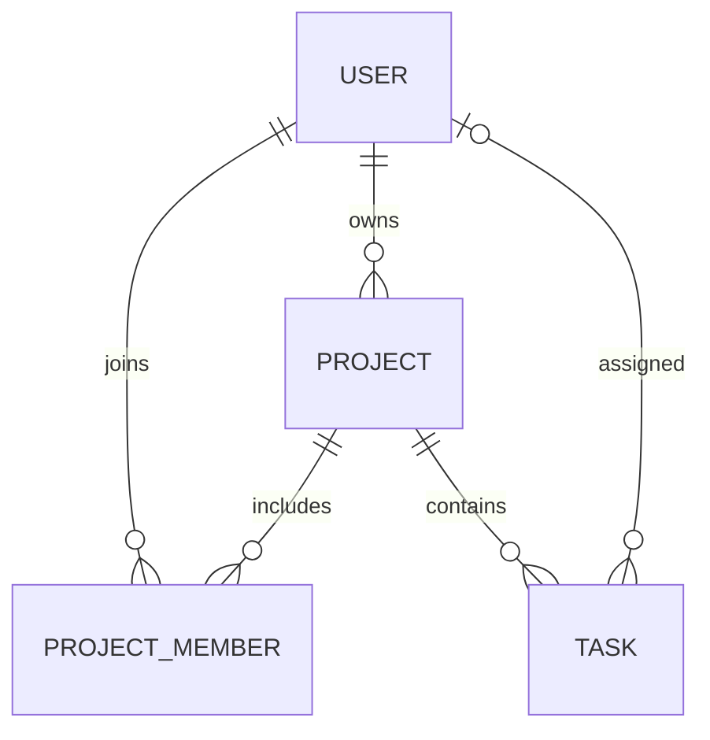

# Projectly

Prosta aplikacja MVC do zarządzania projektami i zadaniami, przygotowana na zaliczenie.
Punktem wyjścia jest [Taskmaster](https://github.com/michalpotapiuk/Taskmaster) w rewizji
`202359fd90d03c598769d3d3de76631261ff0a59` oraz dostarczona specyfikacja implementacyjna.
Projectly jest oddzielnym, uproszczonym projektem: model projektu, zadania i użytkownika
został dostosowany do specyfikacji, a frontend napisany od nowa w Thymeleaf.

## Technologie i wymagania

- JDK 21 (ustaw `JAVA_HOME` na instalację JDK 21).
- Spring Boot 3.5.16, Spring MVC, Spring Security.
- Hibernate / Spring Data JPA, Jakarta Validation, Thymeleaf.
- PostgreSQL 17 uruchamiany przez Docker Compose; H2 w pamięci do demonstracji i testów.
- Docker Desktop z Docker Compose do uruchomienia bazy.
- Maven 3.9.11 pobierany przez dołączony Maven Wrapper; nie trzeba instalować Maven.
- Dostęp do internetu podczas pierwszego budowania.

## Szybka demonstracja bez konfiguracji bazy

Linux / macOS:

```sh
./mvnw spring-boot:run -Dspring-boot.run.profiles=demo
```

Windows:

```powershell
.\mvnw.cmd spring-boot:run "-Dspring-boot.run.profiles=demo"
```

Otwórz http://localhost:8080. Konta demonstracyjne:

| Login | Hasło domyślne | Rola |
|---|---|---|
| admin | Projectly123! | ADMIN |
| anna | Projectly123! | USER |
| jan | Projectly123! | USER |

Hasło możesz zastąpić przez zmienną `SEED_PASSWORD`. Profil `demo` tworzy bazę H2
w pamięci, dwa projekty i cztery zadania. Dane znikają po zatrzymaniu aplikacji.
Nie włączaj profilu demonstracyjnego dla publicznego wdrożenia.
Jeżeli istnieje lokalny plik `.env`, hasło z jego `SEED_PASSWORD` obowiązuje także
w profilu `demo`, zamiast hasła domyślnego w tabeli.

## PostgreSQL w Dockerze

Docker uruchamia bazę danych, a aplikacja Spring Boot działa lokalnie w IntelliJ
lub przez Maven. Plik `compose.yaml` zawiera oficjalny obraz `postgres:17-alpine`,
trwały wolumen danych i kontrolę gotowości bazy.

1. Uruchom Docker Desktop.
2. W katalogu projektu utwórz `.env` na podstawie `.env.example`, jeśli jeszcze go
   nie ma. Ustaw własne `DB_PASSWORD` i `SEED_PASSWORD`. W lokalnym projekcie
   przygotowanym przez asystenta plik `.env` już zawiera losowo wygenerowane hasła.
   Nie nadpisuj tego pliku przy kolejnych uruchomieniach.

3. Z katalogu projektu uruchom bazę, a następnie aplikację:

```sh
docker compose up -d --wait
./mvnw spring-boot:run
```

Windows PowerShell: użyj tych samych poleceń Docker oraz
`.\mvnw.cmd spring-boot:run`.

4. Otwórz http://localhost:8080. Przy pierwszym uruchomieniu pustej bazy
   `SEED_ENABLED=true` tworzy konta `admin`, `anna`, `jan` z hasłem
   z lokalnego `SEED_PASSWORD`, oraz dane przykładów. Hasła zapisują się jako
   BCrypt. Inicjalizator działa tylko wtedy, gdy wszystkie cztery tabele są puste.
   Po utworzeniu kont można ustawić `SEED_ENABLED=false`.

Konfiguracja PostgreSQL jest domyślna. Compose i Spring Boot wczytują ten sam
lokalny plik `.env`; jest pomijany przez Git. Stosuj prosty zapis
`NAZWA=wartość` bez cudzysłowów, spacji, znaków `$`, `#` i backslashy w hasłach,
aby był zgodny z oboma czytnikami. Wygenerowane hasła używają znaków szesnastkowych.
Można też ustawić zmienne środowiskowe zamiast pliku; mają wyższy priorytet.

Połączenie z IntelliJ lub narzędzia do baz:

| Parametr | Wartość domyślna |
|---|---|
| Host | localhost |
| Port | 5432 |
| Baza | projectly |
| Użytkownik | projectly |
| Hasło | wartość `DB_PASSWORD` z `.env` |
| JDBC URL | jdbc:postgresql://localhost:5432/projectly |

Jeżeli port 5432 jest zajęty, zmień `DB_PORT` w `.env`. Aplikacja i Compose
użyją nowego portu. Pełny adres można nadpisać zmienną `DB_URL` w aplikacji.
Baza jest udostępniona tylko na interfejsie `127.0.0.1`.

W IntelliJ ustaw JDK 21 i katalog roboczy na katalog główny Projectly.
Uruchom `org.example.ProjectlyApplication` bez profilu `demo`, aby użyć PostgreSQL.
Hibernate tworzy i aktualizuje schemat przez `ddl-auto=update`.
Aplikacja nie migruje danych ze starego Taskmastera ani MySQL.

Przydatne polecenia:

```sh
docker compose ps
docker compose logs postgres
docker compose exec postgres psql -U projectly -d projectly
docker compose stop
docker compose start --wait
```

Dane pozostają w wolumenie `projectly_postgres_data` po zatrzymaniu lub ponownym
utworzeniu kontenera. Zmiana haseł w `.env` nie zmienia hasła w już utworzonej
bazie; wymaga osobnej zmiany w PostgreSQL. Nie usuwaj wolumenu, jeśli chcesz
zachować dane.

Opis obrazu: [Docker Official Image PostgreSQL](https://hub.docker.com/_/postgres).
Wczytywanie pliku konfiguracyjnego:
[Spring Boot external configuration](https://docs.spring.io/spring-boot/3.5/reference/features/external-config.html).

## Budowanie i testy

```sh
./mvnw clean verify
java -jar target/projectly-1.0.0.jar --spring.profiles.active=demo
```

Możesz także uruchomić plik JAR z PostgreSQL z głównego katalogu projektu,
bez opcji profilu, po uruchomieniu bazy:

```sh
java -jar target/projectly-1.0.0.jar
```

Aktualny plik JAR powstaje w `target/`. Plik w głównym folderze również jest
odświeżany przy przygotowaniu projektu przez asystenta.

Testy wykorzystują oddzielne bazy H2, rzeczywiste repozytoria JPA i MockMvc.
Sprawdzają użytkowników, projekty, członkostwa, zadania, uprawnienia, logowanie,
CSRF, walidację oraz renderowanie wszystkich widoków przy wyłączonym Open Session
in View. Nie wymagają uruchomionej bazy PostgreSQL.

## Funkcjonalności

ADMIN:
- Dashboard ze statystykami globalnymi.
- Tworzenie i edycja użytkowników oraz usuwanie lub blokowanie kont.
- Tworzenie, edycja i usuwanie projektów; wybór właściciela.
- Dodawanie i usuwanie członków projektu.
- Tworzenie, przypisywanie, edycja i usuwanie zadań.
- Statusy TODO / IN_PROGRESS / DONE, priorytety LOW / MEDIUM / HIGH i termin.

USER:
- Dashboard ze statystykami własnych zadań i dostępnych projektów.
- Projekty, których jest właścicielem lub członkiem.
- Własne zadania i filtrowanie ich według statusu.
- Szczegóły i zmiana statusu wyłącznie własnych zadań.

Zakres nie obejmuje zespołów, diagramów, notatek, raportów, ewidencji czasu,
zgłoszeń, podzadań, komentarzy, plików, powiadomień ani osobnego frontendu REST.
Są to zbędne funkcje oryginalnego Taskmastera lub funkcje wykluczone specyfikacją.

## Struktura

```text
src/main/java/org/example/
├── ProjectlyApplication.java
├── config/        SecurityConfig, DataInitializer
├── MOdel/
│   ├── entity/    User, Project, ProjectMember, Task
│   ├── enums/     Role, TaskStatus, Priority
│   └── dto/       UserForm, ProjectForm, TaskForm
├── repository/    cztery interfejsy JpaRepository
├── service/       UserService, ProjectService, TaskService, AccessService
├── Controller/    logowanie, dashboard, projekty, zadania, użytkownicy
└── exception/     wyjątki i obsługa 400/403/404/409
src/main/resources/
├── templates/     fragmenty, login, dashboard, projects, tasks, users, error
├── static/css/    responsywny CSS bez zewnętrznych zależności
├── application.yml
└── application-demo.yml
src/test/          testy usług i przepływów MVC
```

Żądania przechodzą przez Controller → Service → Repository → Database.
Kontrolery obsługują formularze i przekierowania; transakcje i reguły biznesowe
są w usługach. Formularze nie wiążą bezpośrednio encji ani pól takich jak
identyfikator projektu zadania lub hash hasła.

## Model danych i reguły



- `User`: unikalne login i email, imię, nazwisko, hash BCrypt, rola i aktywność.
- `Project`: nazwa, opis, automatyczna data utworzenia i wymagany właściciel.
- `ProjectMember`: osobna encja pośrednia z unikalną parą projekt/użytkownik
  i automatyczną datą dołączenia. Brak bezpośredniego `@ManyToMany`.
- `Task`: tytuł, opis, status, priorytet, opcjonalny termin, automatyczna data,
  wymagany projekt i opcjonalny wykonawca.

Relacje do pojedynczych encji mają `LAZY`; repozytoria pobierają potrzebne dane
przez `EntityGraph`. Kolekcje usuwanych dzieci projektu mają wyłącznie
`CascadeType.REMOVE` i `orphanRemoval`. Żadna relacja nie usuwa kaskadowo użytkownika.
Odwrotne kolekcje w `User` są celowo pominięte: te same relacje reprezentują
klucze obce i zapytania repozytoriów. Encje nie mają metod equals/hashCode/toString
obejmujących relacje.

Dodatkowe zasady:
- Właściciel ma dostęp do projektu bez dodatkowego członkostwa.
- Wykonawca musi być aktywnym członkiem lub właścicielem.
- Usunięcie członka odpina jego zadania; administrator może przypisać je ponownie.
- Zmiana właściciela pozostawia poprzedniego jako członka, zachowując poprawność
  istniejących przypisań; usuwa dodatkowe członkostwo nowego właściciela.
- Usunięcie projektu usuwa jego zadania i członkostwa, pozostawiając użytkowników.
- Usunięcie użytkownika z powiązaniami blokuje konto; bez powiązań usuwa rekord.
- Ostatni aktywny administrator jest chroniony przed zablokowaniem i zmianą roli.
- Zwykła edycja użytkownika zachowuje istniejące hasło.
- Login jest normalizowany do małych liter; email także do małych liter.
- USER widzi na stronie projektu wyłącznie swoje zadania. ADMIN widzi wszystkie.
- Reguły dostępu do zasobów są sprawdzane w usługach, również przy wysłaniu ręcznie
  spreparowanego żądania. Aktywność konta jest sprawdzana przy kolejnych operacjach.
- Rola w nawigacji jest odczytywana z bazy; po zmianie roli należy zalogować się
  ponownie, aby odświeżyć uprawnienia zapisane w sesji Spring Security.
- Sesyjne logowanie, logout przez POST i ochrona CSRF pozostają włączone.

## Scenariusz prezentacji

1. Uruchom profil `demo` i zaloguj się jako `admin`.
2. Utwórz użytkownika, projekt i członkostwo; dodaj zadanie z wykonawcą.
3. Pokaż walidację pustego tytułu i odmowę ponownego dodania członka.
4. Zaloguj się jako wykonawca i zmień status zadania.
5. Pokaż filtrowanie w „Moje zadania” i brak dostępu do administracji.
6. Ponownie jako administrator usuń członka i pokaż odpięte zadanie.

## Podgląd


Raport sprawdzenia projektu znajduje się w [docs/VALIDATION.md](docs/VALIDATION.md).
